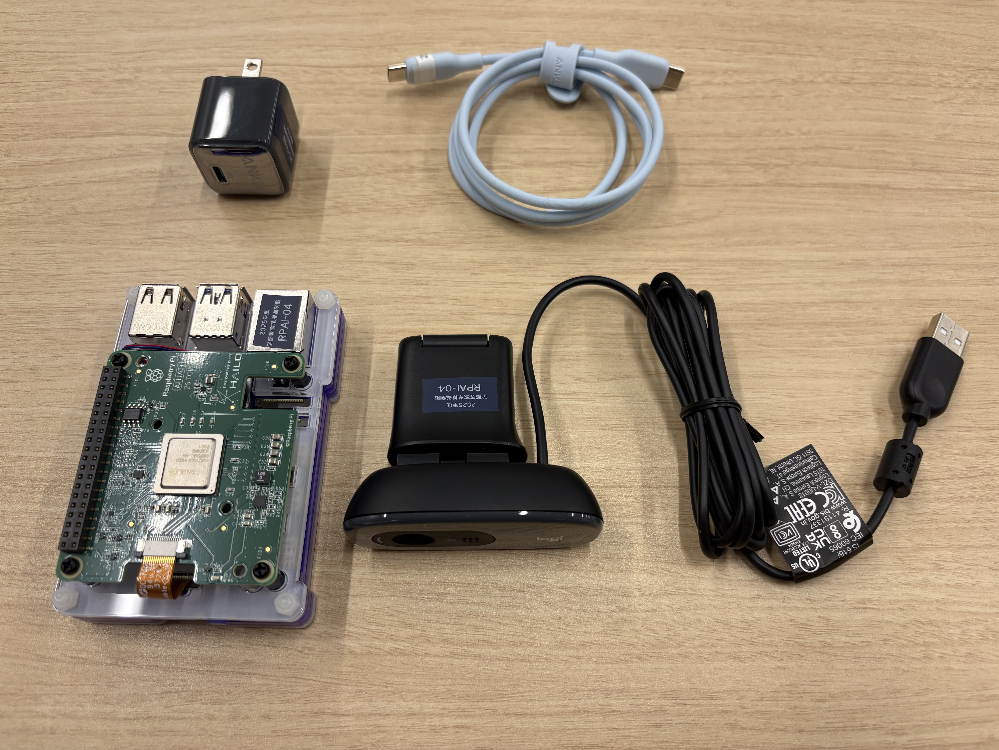
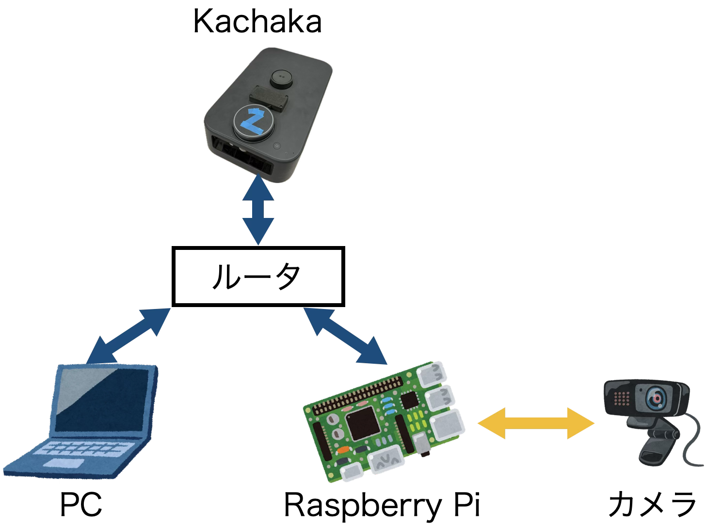

# 9.1 AI活用編概要

## 概要
ここでは深層学習を用いた物体認識や姿勢推定といったロボット開発で多用される手法について実際に動かして体験してみます．また，これらのアプリケーションは多くの計算資源を必要とするためVirtualBoxの仮想マシンではパワー不足になります．そこで，ここではRaspberry Pi AI Kitに搭載のAI専用プロセッサを用いて高速に計算を行います．

## 機材の接続
今回使用するRaspberry Piの機材一式は以下の通りです．
- Raspberry Pi本体（AI HAT+搭載）
- 電源用Type-C充電器
- USB Type-Cケーブル
- Webカメラ



その他，ルータと接続するためのLANケーブルを用意してください．

これまでのカチャカのセットアップに加えて，これらの機材を以下手順で接続し，図のような状態にします．
1.  Raspberry Pi本体とルータをLANケーブルで接続します
2.  WebカメラをRaspberry PiのUSBポートに接続します（USB2.0, 3.0どちらでも可能です）
3.  接続が完了したら電源を接続してください（電源を入れると直ちにRaspberry Piの電源が入ります）



## 接続チェック
機材を全て接続し，RaspberryPiの電源が入ったら，起動するまで2分ほど待ちます．その後，RaspberryPiが正常に接続されているかどうかを確認するため，自分のPCのVirtualBox上のUbuntuからRaspberryPiに接続します．

> [!IMPORTANT]
> 接続先のRaspberryPiにあわせてホスト名（接続コマンドの `rpai01.local` の部分）を変更してください．
> 自分が使用しているRaspberryPiの番号に応じて `rpai01.local` 〜 `rpai05.local` のいずれかに変更してください．

まず，Ubuntu上でターミナルを開きます．その後，以下のコマンドを入力してRaspberryPiに接続します．その後パスワードを確認されるのでログインパスワードを入力してください．なお，パスワードの入力時には画面に何も表示されませんが入力できています．

```bash
ssh tamagawa@rpai01.local
```

以上で，無事ログインできればセットアップは完了です．
ログアウトする場合は以下のように入力します．

```bash
logout
```