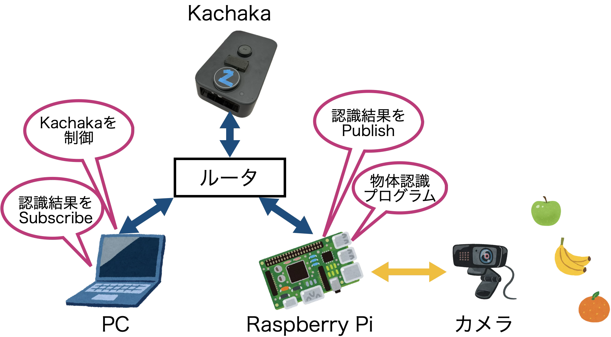
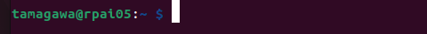
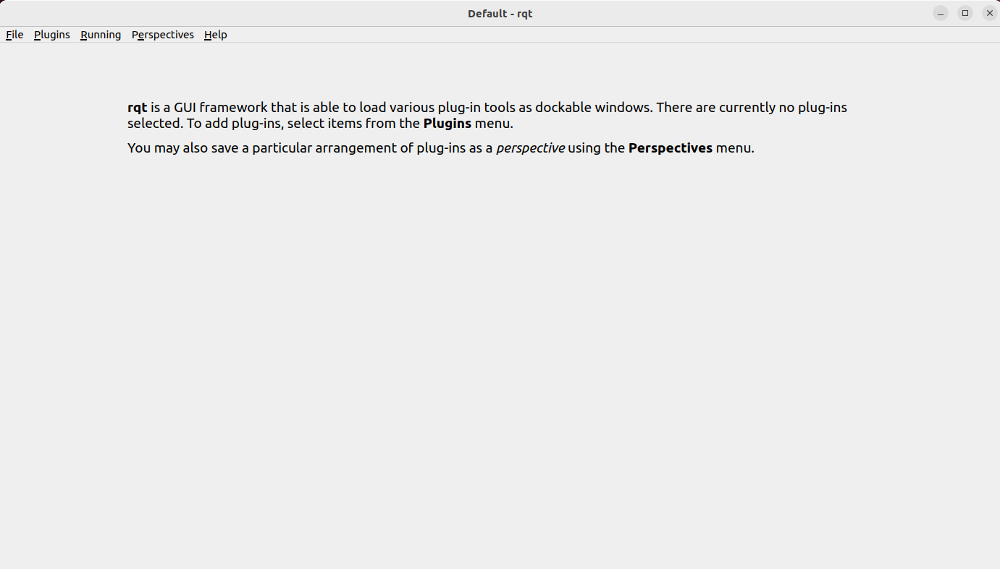
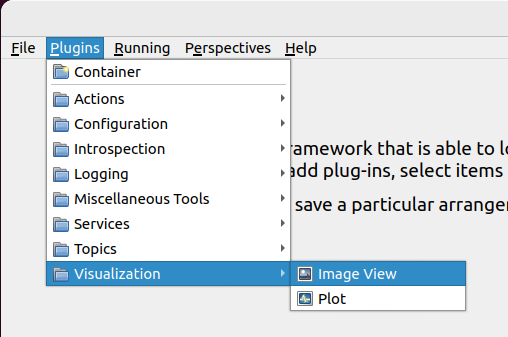
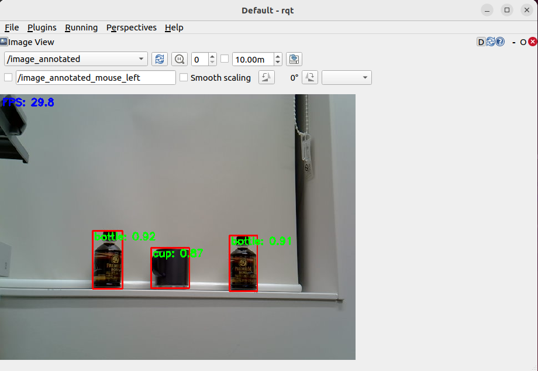

# 9.1 物体認識を動かしてみよう

## 概要
----
ここではYOLOを用いた物体認識を動作させます．物体認識プログラムはRaspberry Pi上に実装済みですので実行するだけで認識結果がPublishされます．その結果をVirtualBoxを実行している自分のPC環境でSubscribeして利用します．このシステムの外観図を以下に示します．



なお，RaspberryPi上に実装された物体認識プログラムについて詳しく知りたい場合は，[horilaboratory/robot_project_ai](https://github.com/horilaboratory/robot_project_ai)を参照してください．

## 物体認識プログラムの起動と認識結果の確認
----
### RaspberryPiへの接続

まずは，[9.1 準備](/tutorials/tutorial9.1.md)に説明されているとおり，RaspberryPiを接続し，電源を入れてください．電源投入後，起動が完了するまで待ちます（2分ほど待てば起動しているはずです）．

次に，RaspberryPi上で物体認識プログラムを起動するためにRaspberryPi環境にログインします．ログインはUbuntuの端末を開き，以下のSSHコマンドを入力します．

> [!IMPORTANT]
> 接続先のRaspberryPiにあわせてホスト名（接続コマンドの `rpai01.local` の部分）を変更してください．
> 自分が使用しているRaspberryPiの番号に応じて `rpai01.local` 〜 `rpai05.local` のいずれかに変更してください．

```bash
ssh tamagawa@rpai01.local
```

パスワードを聞かれるので，ログインパスワードを入力してください．ログインが完了すると，ターミナルのプロンプト（左側に書いてある文字）が以下のように， `tamagawa@rpai0X:~ $` (Xは利用中のRaspberry Piの番号)に変わります．**この状態で入力されたコマンドは全てRaspberry Pi上で実行されます．**



### 物体認識プログラムの起動

次に，物体認識プログラムを起動します．起動するためのプログラム（シェルスクリプト）が `~/robot_project_ai`ディレクトリに配置されていますので，そのディレクトリまで移動し，シェルスクリプトを起動します．

```bash
cd ~/Documents/robot_project_ai
./run_obj_detection.sh
```

プログラムを起動し，正常にカメラが動作していれば以下のように表示されます．以上で物体認識プログラムが起動し，その認識結果がROSのTopicとしてPublishされています．

```txt
[INFO] [1795572914.542711781] [yolo_hailo_publisher]: HEF 読み込み完了 (入力 640x640) / カメラ /dev/video0
```

> [!NOTE]
> カメラの読み込みに失敗した場合は，カメラの接続や起動スクリプトに記述されているカメラのデバイス名を確認してください．
> カメラのデバイス名は， `run_obj_detection.sh` の以下の部分です．
> ```bash
> CAMERA_DEVICE=/dev/video0
> ```
>
> カメラデバイス名を確認する場合は以下のコマンドを実行し， `C270 HD WEBCAM` と書かれている部分に記載されている `/dev/videoX` (Xは数字)を確認してください．
> ```bash
> # デバイス一覧を表示するコマンド
> v4l2-ctl --list-devices
> ```

### 認識結果の確認

> [!IMPORTANT]
> この部分の作業は自分のVirtualBox上のUbuntuで行いますので，これまでの作業で使った端末は開いたままにして新しく端末を開いてください．

Raspberry PiからPublishされている物体認識結果をSubscribeして確認してみましょう．これまでの作業で用いていた端末は開いたままにして新しく端末を開いてください．

新しく開いた端末で以下のコマンドを入力します．

```bash
rqt
```

すると以下のようなビューワが開きます．



ここで，上部のメニューから， `Plugins` > `Visualization` > `Image View` を選択します．するとPublishされているTopicの画像を表示するためのウィンドウが生成されます．



生成されたウィンドウのプルダウンメニューから， `/image_annotated` を選択します．するとRaspberry Pi上で実行されている物体認識結果が表示されます．



表示されれば問題なく物体認識プログラムが動作し，結果がPublishされています．確認後は開いていても良いですし，終了したい場合は，バツボタンを押してボタンを押してウィンドウを閉じてください．


## 認識結果のサブスクライブ
----

### 概要と準備

物体認識結果をサブスクライブし，認識結果によってカチャカを制御するプログラムを作成できます．物体認識の結果は `vision_msgs/msg/Detection2DArray` 型のメッセージとして `/detections` トピックにパブリッシュされています．

準備として以下のコマンドで `vision_msgs` をインストールします．
```bash
apt update
sudo apt install -y ros-${ROS_DISTRO}-vision-msgs
```

> [!NOTE]
> ROS関連の証明書切れでインストールできないとエラーが出た場合は，以下のコマンドを実行した上で上記のインストールコマンドを再度実行してください．
> ```bash
> # 1. 古いリポジトリ設定と鍵を削除
> sudo rm -f /etc/apt/sources.list.d/ros2.list /etc/apt/sources.list.d/ros2-latest.list /usr/share/keyrings/ros-archive-keyring.gpg
> 
> # 2. curl を用意
> sudo apt update && sudo apt install -y curl
> 
> # 3. ros2-apt-source の最新版をダウンロードしてインストール
> export ROS_APT_SOURCE_VERSION=$(curl -s https://api.github.com/repos/ros-infrastructure/ros-apt-source/releases/latest | grep -F '"tag_name"' | awk -F'"' '{print $4}')
> curl -L -o /tmp/ros2-apt-source.deb "https://github.com/ros-infrastructure/ros-apt-source/releases/download/${ROS_APT_SOURCE_VERSION}/ros2-apt-source_${ROS_APT_SOURCE_VERSION}.$(. /etc/os-release && echo $VERSION_CODENAME)_all.deb"
> sudo apt install -y /tmp/ros2-apt-source.deb
> rm -f /tmp/ros2-apt-source.deb


### 人を検出したら表示する

ここでは，認識結果を受け取り，人が検出されていればターミナルに「人を検出！！」と表示します．メッセージの主な構造は以下のとおりです．

- `msg.detections`：1枚の画像から検出された物体のリストです．検出がなければ空になります．
- `detection.results`：1つの物体に対する認識結果のリストです．
- `result.hypothesis.class_id`：物体の種類です．この物体認識プログラムでは，人の場合は文字列 `"person"` になります．
- `result.hypothesis.score`：その認識結果の信頼度です．
- `detection.bbox`：検出された物体を囲む矩形の中心座標とサイズです．このプログラムでは元画像のピクセル単位です．

Raspberry Pi上で物体認識プログラムを起動したまま，自分のVirtualBox上のUbuntuで新しい端末を開き，次のコマンドでファイルを作成します．

```bash
mkdir ~/robopro-ai
cd ~/robopro-ai
code detect_person.py
```

以下を貼り付けて保存してください．

```python
import rclpy
from rclpy.node import Node
from vision_msgs.msg import Detection2DArray


class PersonSubscriber(Node):
    def __init__(self):
        super().__init__('person_subscriber')
        # /detections を受信するたびに detection_callback を呼ぶ
        self.subscription = self.create_subscription(
            Detection2DArray, '/detections', self.detection_callback, 10
        )

    def detection_callback(self, msg):
        # 画像内の物体と，それぞれの認識結果を順に調べる
        for detection in msg.detections:
            for result in detection.results:
                # このYOLOプログラムでは人のクラス名は "person"
                if result.hypothesis.class_id == 'person':
                    print('人を検出！！', flush=True)
                    return  # 1枚の画像につき1回だけ表示する


def main():
    rclpy.init()
    node = PersonSubscriber()
    try:
        rclpy.spin(node)  # メッセージを待ち，受信時にコールバックを実行する
    except KeyboardInterrupt:
        pass
    finally:
        node.destroy_node()
        rclpy.shutdown()


if __name__ == '__main__':
    main()
```

保存したら，以下のようにPythonスクリプトを実行します．

```bash
python3 detect_person.py
```

するとカメラに人が写ったときに「人を検出！！」と表示されます．

## 発展
----
- 人出はなくりんごやバナナなど別の物体を発見したときに通知するように変更してみましょう
- 認識した物体の座標を取得してみましょう